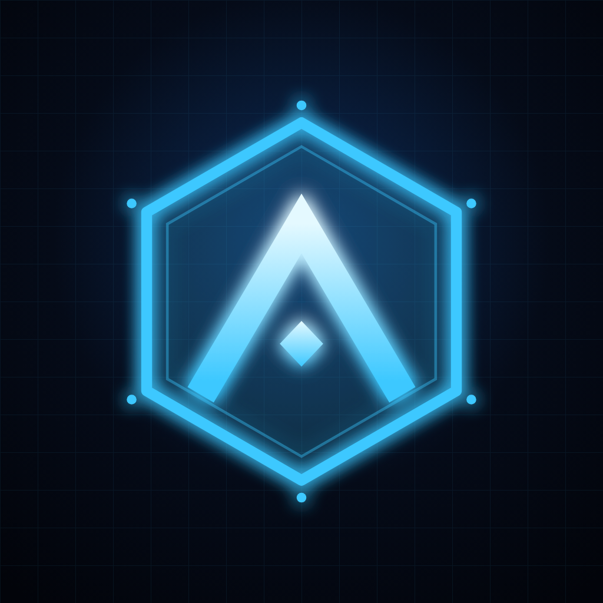
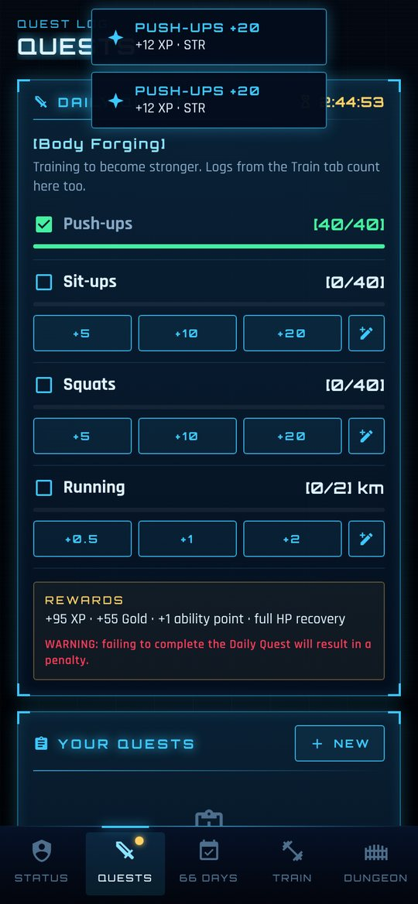
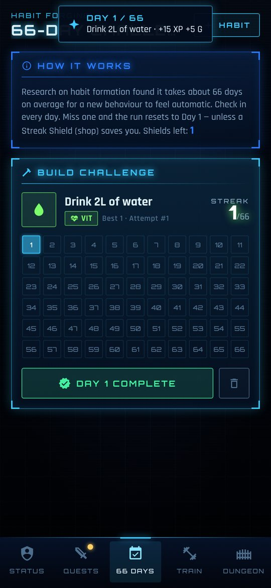
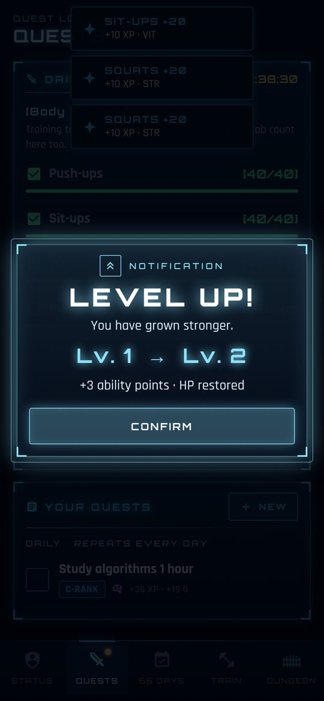
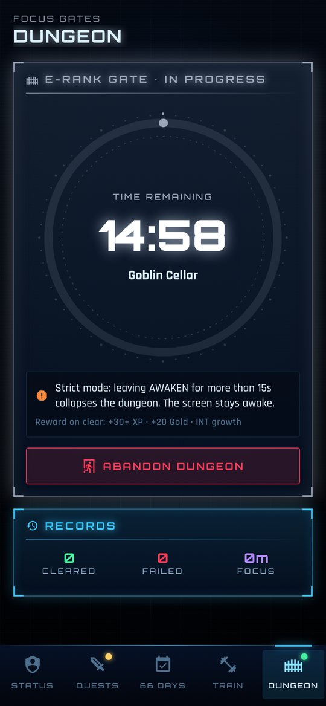
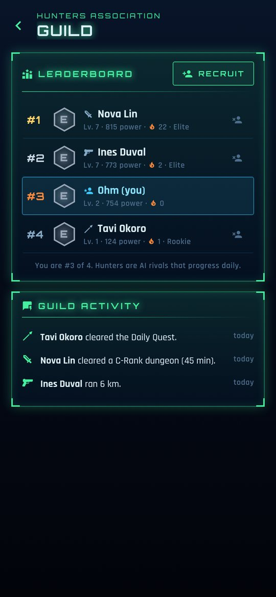
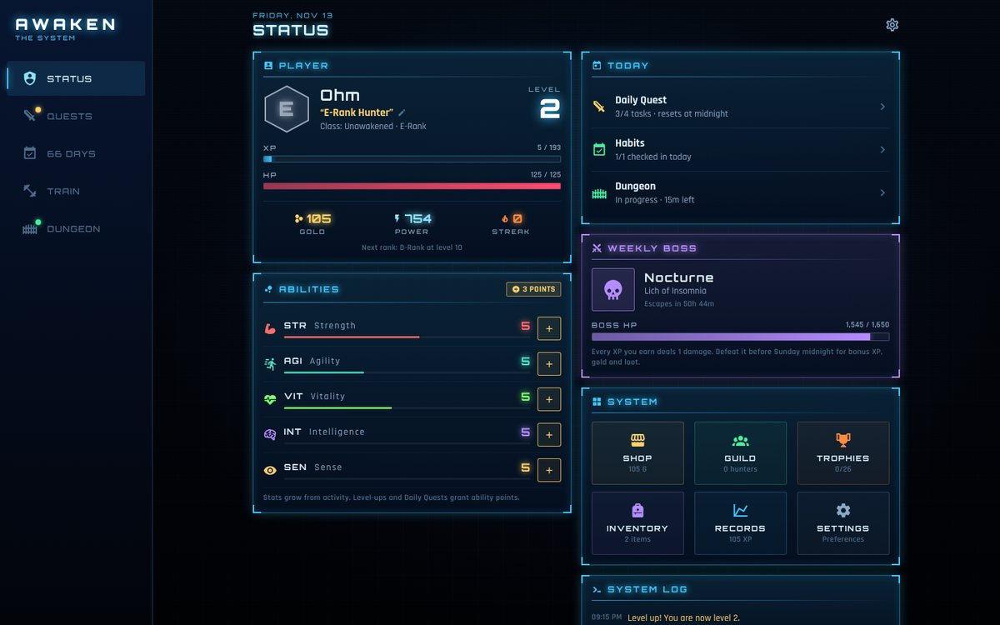

<div align="center">



# AWAKEN

**Level up your real life.** A self-improvement RPG with a holographic "System" interface — daily quests, 66-day habit challenges, workouts that raise your stats, focus dungeons, weekly bosses and penalties when you slack off.

iPhone · Android · Web — one codebase (Expo / React Native)

</div>

<p align="center">
  
  
  
  
</p>
<p align="center">
  
  
  
</p>

---

## 📲 Get it on your phone

| iPhone (easiest) | Android |
| :-: | :-: |
|  |  |
| Open **[anmayvaa.github.io/awaken](https://anmayvaa.github.io/awaken/)** in **Safari** → **Share** → **Add to Home Screen**. It runs full-screen like a normal app. | Download **[AWAKEN.apk](https://github.com/AnMayVaa/awaken/releases/download/android-latest/AWAKEN.apk)** and open it (allow installs from your browser if asked). |

Both are rebuilt automatically by GitHub Actions on every push to `main`.

**Native iPhone app (with notifications):** install **Expo Go** from the App Store, then on your computer:

```bash
npm install
npx expo start --tunnel   # scan the QR code with the iPhone Camera
```

> A standalone App Store / TestFlight build needs an Apple Developer account. With one: `npx eas-cli build -p ios --profile preview`.

---

## ⚔️ Features

| | |
| --- | --- |
| **Status window** | Level, E → S hunter rank, title, class, XP, HP, gold, combat power. Stats **STR / AGI / VIT / INT / SEN** grow from what you do, plus ability points to assign. |
| **Daily Quest** | Auto-generated training quest ("Body Forging") that scales with your level and difficulty (Casual / Hunter / Nightmare). Choose 1–5 exercises. |
| **Penalty Zone** | Miss the Daily Quest → HP damage, a mandatory Penalty Quest and halved XP until you clear it. Reach 0 HP and you lose XP. |
| **66-Day Habits** | Build or quit a habit. 66-cell grid, streak resets to Day 1 on a miss — unless a **Streak Shield** saves you. Finish all 66 days to *forge* the habit. |
| **Training** | 14 exercises (strength, cardio, core, mind). Every log gives XP, trains a stat, counts toward the Daily Quest and damages the boss. |
| **Dungeons** | Focus timer from E-Rank (15 min) to S-Rank (120 min). Strict mode: leave the app for more than 15 s and the dungeon collapses. Keeps the screen awake. |
| **Weekly Boss** | A new boss every Monday. Every XP you earn deals 1 damage. Beat it by Sunday midnight for big XP, gold and loot. |
| **Shop & rewards** | Spend gold on HP Potions, Streak Shields, Penalty Passes, XP Elixirs (×2 XP) — or on **your own real-life rewards** ("1 hour of gaming = 300 G"). |
| **Guild** | Recruit AI hunters (Rookie → Elite) who level up every day. Leaderboard + activity feed. |
| **Trophies & titles** | 26 achievements, equippable titles. |
| **System alerts** | `[SYSTEM]` popups for level-ups, rank-ups, penalties and boss kills. On phones: morning Daily Quest alert, evening penalty warning, dungeon and boss notifications. |
| **Cloud sync** | Email + password accounts (Supabase). Local-first — works fully offline, syncs when signed in. |
| **Any screen size** | Phone, tablet and desktop layouts (side navigation + two columns on wide screens). |

---

## 🛠 Development

```bash
npm install
npm start          # Expo dev server (press i / a / w)
npm run web        # web in the browser
npm test           # game-engine tests
npm run typecheck
npm run build:web  # static PWA in dist/
```

### Project structure

```
src/
  app/            screens (Expo Router) — (tabs)/ Status, Quests, 66 Days, Train, Dungeon + shop, guild, achievements, records, settings
  game/           pure game logic: engine (XP, ranks, rollover, penalties, boss), achievements, bots, constants
  store/          zustand stores (persisted save + System alert queue)
  lib/            Supabase client + sync, notifications, haptics
  ui/             holographic UI kit (panels, bars, alerts, tab bar, onboarding)
supabase/schema.sql   cloud-save table + Row Level Security
scripts/pwa.js        turns the web export into an installable PWA
```

### Turning on accounts & cloud sync

1. Create a free project at [supabase.com](https://supabase.com).
2. Open **SQL Editor**, paste [`supabase/schema.sql`](supabase/schema.sql) and run it.
3. Copy **Project URL** and the **publishable (anon) key** from *Project Settings → API*.
4. Local: copy `.env.example` to `.env` and fill both values.
5. Builds: in GitHub → *Settings → Secrets and variables → Actions → **Variables***, add `EXPO_PUBLIC_SUPABASE_URL` and `EXPO_PUBLIC_SUPABASE_KEY`, then re-run the workflows.

The publishable key is meant to be public; every row is protected by RLS so players can only read and write their own save. Without these values the app simply runs offline.

### GitHub Pages

The **Web app** workflow deploys to Pages. If it's the first run, set *Settings → Pages → Source* to **GitHub Actions**.

---

<sub>Original design — not affiliated with any anime, game or app. The 66-day figure comes from habit-formation research (Lally et al., 2010), which found an average of ~66 days for a behaviour to become automatic.</sub>
