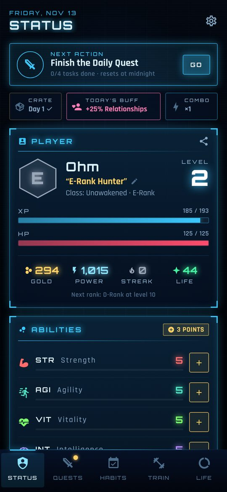
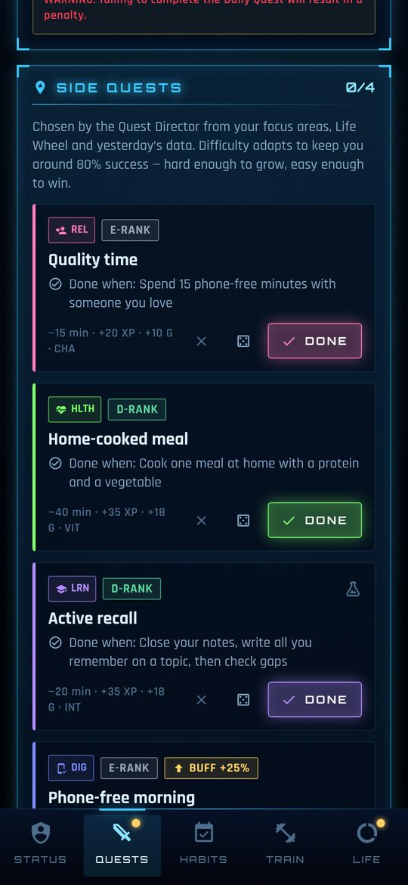
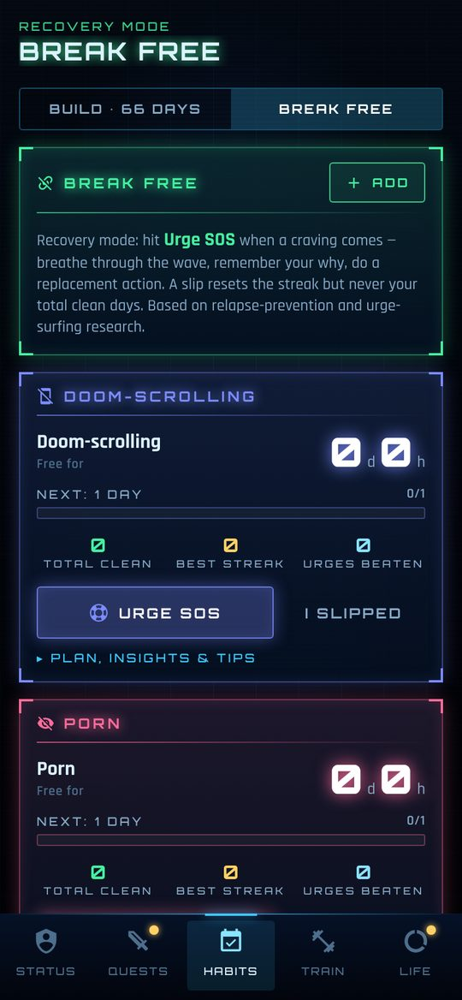
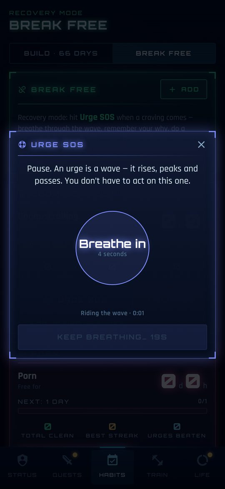
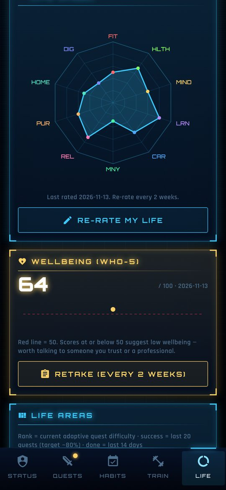
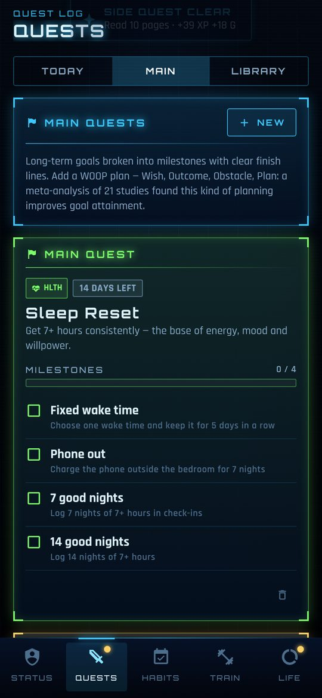
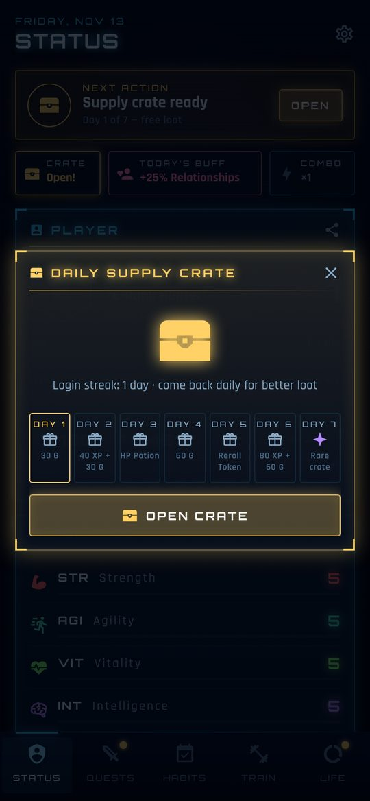
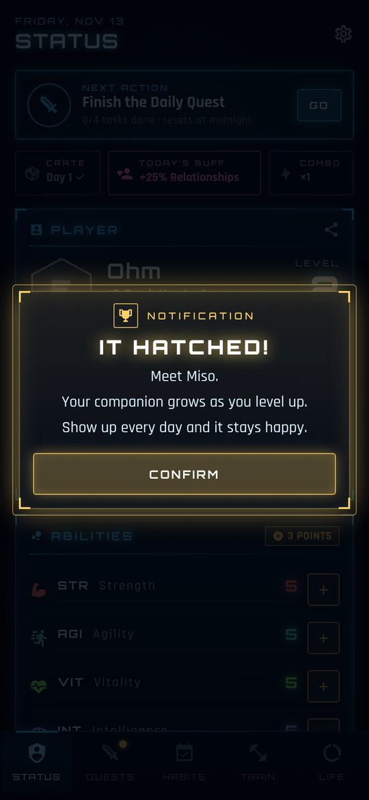

<div align="center">


# AWAKEN

**Level up your real life.** A self-improvement RPG with a holographic "System" interface — daily quests, 66-day habit challenges, workouts that raise your stats, focus dungeons, weekly bosses and penalties when you slack off.

iPhone · Android · Web — one codebase (Expo / React Native)

</div>

<p align="center">
  
  
  
  
</p>
<p align="center">
  
  
  
  
</p>
<p align="center"></p>

---

## 📲 Get it on your phone

| iPhone (easiest) | Android |
| :-: | :-: |
|  |  |
| Open **[anmayvaa.github.io/awaken](https://anmayvaa.github.io/awaken/)** in **Safari** → **Share** → **Add to Home Screen**. It runs full-screen like a normal app. | Download **[AWAKEN.apk](https://github.com/AnMayVaa/awaken/releases/download/android-latest/AWAKEN.apk)** and open it (allow installs from your browser if asked). |

Both are rebuilt automatically by GitHub Actions on every push to `main`.

**Native iPhone app (with notifications):** install **Expo Go** from the App Store, then on your computer:

```bash
npm install
npx expo start            # same Wi-Fi: scan the QR code with the iPhone Camera
# different network? npx expo login  (free account), then: npx expo start --tunnel
```

> A standalone App Store / TestFlight build needs an Apple Developer account. With one: `npx eas-cli build -p ios --profile preview`.

---

## ⚔️ Features

**Your whole life is the game: 10 areas.** Fitness · Health & Sleep · Mind · Learning · Career · Money · Relationships · Purpose · Home · Digital Balance. There are 7 stats: STR, AGI, VIT, INT, SEN, CHA (charisma) and WIL (willpower).

| | |
| --- | --- |
| **Side Quests (adaptive)** | A Quest Director picks 2–6 quests a day from a **357-quest library**. It uses your focus areas, Life Wheel and yesterday's data (sleep, screen time, steps, mood). Difficulty adapts per area to keep you near **80% success**. Every quest has a concrete *Done when* criterion. Some are auto-verified from steps, workouts, focus time and check-ins. |
| **AI quests (Gemini)** | One tap asks Gemini (through your private Supabase function) for personal quests — "exam on Friday", "feeling lonely"… Sensitive data stays on the device. |
| **Main Quests & Campaigns** | Long-term goals with milestones, WOOP plans and tracked numbers. There are 12 ready-made campaigns: Couch to 5K, Sleep Reset, Emergency Fund, Reconnect 30, Digital Detox 30, Career Launch… |
| **Break Free (recovery mode)** | Quit porn, doom-scrolling, gaming, sugar, smoking, alcohol, gambling or procrastination. A clean-time streak resets on a slip, but **total clean days are kept** and a slip costs no HP. **Urge SOS** walks you through breathing, your why, your plan and a replacement action. A trigger log shows your riskiest times, and milestones come at 1 → 365 days. |
| **Life tab — real progress** | 30-second daily check-in (mood, energy, sleep, screen time, steps), **Life Wheel** radar, **WHO-5 wellbeing** (a validated scale), trends, a 12-week activity heatmap and weekly reviews. The **Life Score** blends wellbeing, satisfaction and consistency. |
| **Phone data** | Steps are read automatically from the iPhone's motion sensor (works in Expo Go). Screen time and sleep are entered in the check-in. |
| **Daily Quest & Penalty Zone** | A scaling training quest. Miss it → HP damage + a Penalty Quest. |
| **66-day habits** | Habit grid with Streak Shields (missing one day doesn't break habit formation). |
| **Training & Dungeons** | 14 exercises that raise stats. Focus dungeons last 15–120 minutes, and strict mode collapses the dungeon if you leave the app. |
| **Weekly boss · Guild bots · Shop** | Every XP damages the boss. AI rivals level up daily. Spend gold on items or your own real-life rewards. |

### Life trackers (v3) — one **+** button logs anything in ≤ 3 taps

| | |
| --- | --- |
| **Quick Log (+)** | The round button in the tab bar: water, meal, spending, Top 3, skill time, reach out, workout, Urge SOS, check-in. |
| **Fuel (nutrition)** | Tap what was on the plate (protein, veggies, fruit, grains, home-cooked, fast food, sugary, fried) — no calorie counting. Water tracker. 7-day Fuel score. Veggies deal bonus boss damage, protein on training days feeds STR, water restores HP. |
| **Treasury (money)** | Log spending in ฿ with need/want, monthly budgets per category, no-spend days, **Impulse Shield** (hold a want for 24 h — skipping counts as an urge resisted) and savings goals that pay gold at 25/50/75/100 %. |
| **Top 3** | Morning plan: three priorities, bonus when all are done. |
| **Skills** | Log practice minutes; tiers Novice → Apprentice (5 h) → Adept (20 h) → Expert → Master → Grandmaster. |
| **People** | Reminders to contact family and friends on your rhythm; contacts train CHA. |
| **Insights** | Honest same-person comparisons from your own data (“on days you train, mood is +0.8 higher”) once there is a week of logs. |
| **Seasons** | 66-day seasons with a 10-tier reward track; unclaimed rewards are auto-claimed. |

All trackers feed side-quest auto-verification (water, veg/fruit, protein, fast food, wants spending, no-spend, skill minutes, contacts, Top 3) and the AI Quest Director.

### Gimmicks (all optional, none punishing)

**Next Action** card (always tells you the one thing to do now) · **Daily Supply Crate** with a 7-day login calendar · **Today's Buff** (+25% XP in one area) · **Combos** up to ×1.25 · **Critical clears** ×2 · **Loot drops** · **Urgent Quests** (60-minute bonus quests, no penalty if missed) · **Weekly Challenges** · **Companion** that hatches and evolves as you level (owl, cat, hound, turtle, penguin, unicorn) · Lucky Charm & Reroll Token items · streak flames · particle bursts on level-up · shareable **Hunter License** · tip of the day · 52 achievements & titles.

📚 **Why it's built this way:** [docs/RESEARCH.md](docs/RESEARCH.md) — evidence and sources for every system.

---

## 🛠 Development

```bash
npm install
npm start          # Expo dev server (press i / a / w)
npm run web        # web in the browser
npm test           # game-engine tests
npm run typecheck
npm run build:web  # static PWA in dist/
```

### Project structure

```
src/
  app/            screens (Expo Router) — (tabs)/ Status, Quests, 66 Days, Train, Dungeon + shop, guild, achievements, records, settings
  game/           pure game logic: engine (XP, ranks, rollover, penalties, boss), director, quest library,
                  tracking (v3 selectors, insights) + life3 (v3 actions), achievements, bots, constants
  store/          zustand stores (persisted save + System alert queue)
  lib/            Supabase client + sync, notifications, haptics
  ui/             holographic UI kit (panels, bars, alerts, tab bar, onboarding)
supabase/schema.sql   cloud-save table + Row Level Security
scripts/pwa.js        turns the web export into an installable PWA
```

### Turning on accounts & cloud sync

1. Create a free project at [supabase.com](https://supabase.com).
2. Open **SQL Editor**, paste [`supabase/schema.sql`](supabase/schema.sql) and run it.
3. Copy **Project URL** and the **publishable (anon) key** from *Project Settings → API*.
4. Local: copy `.env.example` to `.env` and fill both values.
5. Builds: in GitHub → *Settings → Secrets and variables → Actions → **Variables***, add `EXPO_PUBLIC_SUPABASE_URL` and `EXPO_PUBLIC_SUPABASE_KEY`, then re-run the workflows.

### AI quests (optional, free tier)

1. Get a Gemini API key at [aistudio.google.com/apikey](https://aistudio.google.com/apikey).
2. Supabase → **Edge Functions → Secrets**: add `GEMINI_API_KEY` (optional: `GEMINI_MODEL`, `AI_DAILY_LIMIT`).
3. Supabase → **Edge Functions → Deploy a new function** named `ai-quests`, and paste [`supabase/functions/ai-quests/index.ts`](supabase/functions/ai-quests/index.ts). The CLI alternative is `supabase functions deploy ai-quests`.
4. Make sure you ran the latest `supabase/schema.sql` (it adds the `ai_requests` table used for the daily limit).
5. In the app: sign in → Quests → Side Quests → **AI quests**.

The publishable key is meant to be public; every row is protected by RLS so players can only read and write their own save. Without these values the app simply runs offline.

### GitHub Pages

The **Web app** workflow deploys to Pages. If it's the first run, set *Settings → Pages → Source* to **GitHub Actions**.

---

<sub>Original design — not affiliated with any anime, game or app. The 66-day figure comes from habit-formation research (Lally et al., 2010), which found an average of ~66 days for a behaviour to become automatic.</sub>
